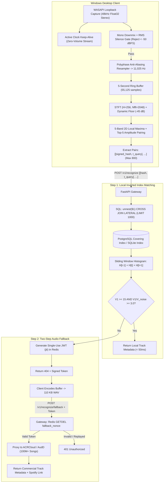

# Song Detector 🎵

[](https://www.python.org/downloads/)
[](LICENSE)
[]()
[]()

A production-grade system audio recognition service modeled after Shazam's acoustic landmark fingerprinting algorithm ([Wang, 2003](https://www.ee.columbia.edu/~dpwe/papers/Wang03-shazam.pdf)). 

Song Detector captures audio directly from Windows application playback via **WASAPI loopback** (Spotify, YouTube, games, browsers) without microphone bleed, extracts noise-resilient time-frequency constellation landmarks, performs sub-second matching against an indexed covering table, and provides an authenticated two-step fallback proxy to commercial providers (ACRCloud / AudD).

---

## 🏛 Architecture Overview



---

## ✨ Engineering Highlights

- **Lossless System Capture**: Interfaces directly with Windows Audio Session API (`WASAPI`) in loopback mode with a zero-volume render keep-alive to prevent thread stalling during silence.
- **Strict Anti-Aliasing**: Evaluates a Kaiser-windowed polyphase sinc filter resampling native $48\text{ kHz}$ to canonical $11,025\text{ Hz}$ mono, providing over $52\text{ dB}$ stopband attenuation above $5\text{ kHz}$.
- **Acoustic Invariance**: Amplitude is excluded from the 32-bit hash key, guaranteeing invariance against volume normalizers, bass boost, and lossy 64 kbps MP3 compression.
- **5 Logarithmic Frequency Bands**: Subdivides spectrum ($27\text{ Hz}\text{–}5000\text{ Hz}$) into 5 perceptual bands with 2D local maxima quotas, ensuring uniform feature density across basslines, vocals, and percussion.
- **Boundary-Free Histogram Scoring**: Discards rigid floor division in favor of an unquantized integer histogram with a 3-frame sliding window sum ($\text{Score}(t) = H[t-1] + H[t] + H[t+1]$), absorbing fractional frame jitter.
- **In-Track Prominence Evaluation**: Measures signal-to-noise ratio ($V_1 / V_{\text{noise}} \ge 3.0$) within the track's own timeline, eliminating duration bias and false-positive collisions.
- **Dual-Backend Storage**: Automatically leverages PostgreSQL's B-Tree covering index (`INCLUDE (song_id, offset_frames)`) and `CROSS JOIN LATERAL` when available, falling back to a local zero-config SQLite index for standalone desktop execution.
- **Replay-Protected Fallback Proxy**: Single-use JWT nonces are atomically deleted via Redis `GETDEL`, protecting commercial provider quotas while shielding paid API credentials from client binaries.

---

## 📂 Repository Structure

```
song-detector/
├── .github/workflows/ci.yml   # Automated GitHub Actions test workflow
├── docs/                      # Deep-dive technical specifications
│   ├── run-guide.md           # Step-by-step operator and execution guide
│   ├── architecture.md        # Complete system architecture and data flow
│   ├── dsp-specification.md   # Mathematical equations and bit layouts
│   ├── api-reference.md       # OpenAPI endpoints and payload schemas
│   └── future-implementations.md # Scalability roadmap (Rust SIMD, COPY FREEZE)
├── client/                    # Desktop loopback capture & DSP
│   ├── capture.py             # WASAPI loopback recorder with silence keep-alive
│   ├── preprocessor.py        # RMS silence gate and polyphase resampler
│   ├── fingerprinter.py       # STFT, 5-band peak picker, and 32-bit bit packer
│   ├── test_capture.py        # Interactive hardware diagnostic utility
│   ├── notifier.py            # Windows native toast notifications
│   ├── tray_app.py            # System tray daemon with global Ctrl+Alt+S hotkey
│   └── agent.py               # Desktop recognition daemon (single or continuous)
├── backend/                   # Recognition service & database
│   ├── app.py                 # FastAPI service and ACRCloud/AudD proxy
│   ├── db.py                  # Dual-engine PostgreSQL covering index / SQLite
│   ├── matcher.py             # Sliding-window histogram and prominence evaluator
│   └── fallback.py            # Redis atomic single-use token manager
├── worker/                    # Catalog ingestion pipeline
│   ├── ingest.py              # Directory scanner, hash pruner, and batch loader
│   └── generate_demo_track.py # Polyphonic multi-band audio generator
└── tests/                     # 18 automated unit and end-to-end tests
    ├── test_bit_packing.py    # Bit layout, signed int32 conversions, boundaries
    ├── test_dsp.py            # Magnitude floor, 2D local max, amplitude pairing
    ├── test_matcher.py        # Sliding window, jitter absorption, prominence
    ├── test_resampler.py      # Stopband attenuation and RMS gate checks
    ├── test_fallback.py       # Token lifecycle and replay attack prevention
    └── test_end_to_end.py     # End-to-end crop recognition & noise rejection
```

---

## 🚀 Quickstart

### 1. Setup Environment
```powershell
conda create -n song-detector python=3.11 -y
conda activate song-detector
pip install -r requirements.txt
```

### 2. Verify with Automated Tests
```powershell
pytest -v
```

### 3. Run Hardware Diagnostic
Verify loopback capture directly from your speakers/headphones:
```powershell
python client/test_capture.py
```

### 4. Run Song Identification
In **Terminal 1**, start the backend API:
```powershell
python -m backend.app
```

In **Terminal 2**, start playback on Spotify / YouTube and identify the track:
```powershell
python client/agent.py --once
```

---

## 📚 Technical Documentation

- [Operator & Execution Guide](docs/run-guide.md): Complete setup and troubleshooting guide.
- [System Architecture](docs/architecture.md): Threat model, data flow, and database design.
- [DSP & Mathematical Specification](docs/dsp-specification.md): Equations, bit allocations, and proof of invariance.
- [API Reference](docs/api-reference.md): Endpoints, JSON schemas, and response codes.
- [Implementation Status & Future Roadmap](docs/future-implementations.md): Optimization blueprint.

---

## 📜 License

This project is licensed under the MIT License - see the [LICENSE](LICENSE) file for details.
