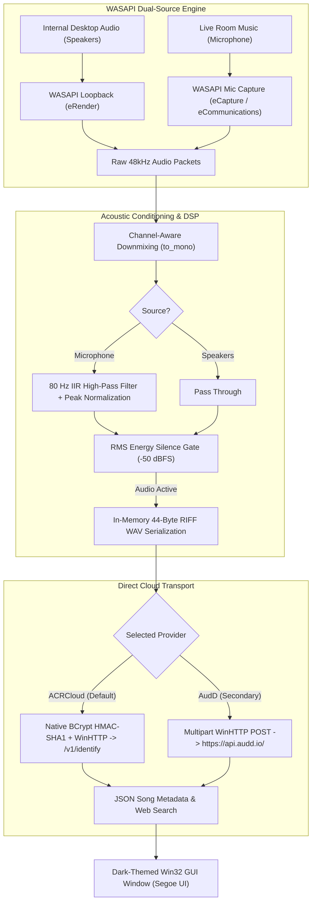

# HearThis 🎵

[](https://en.wikipedia.org/wiki/C%2B%2B17)
[]()
[]()
[](LICENSE)
[]()

HearThis is a lightweight, high-performance native Windows desktop audio recognition application written in modern C++17.

HearThis identifies music playing on your PC or in the room around you:
1. **Internal Desktop Audio (Speakers)**: Uses **WASAPI loopback** to capture playback directly from Spotify, YouTube, games, and web browsers without microphone bleed.
2. **Live Room Music (Microphone)**: Captures audio from external sound sources (smartphones, radio, TV, room speakers) with real-time acoustic signal conditioning (80 Hz rumble removal and bounded peak normalization).

Identifications query direct cloud API providers (**ACRCloud** and **AudD**) with sub-second response times, zero third-party dependencies, and zero background telemetry.

---

## 💾 Download for Windows

Get the latest release directly from **[GitHub Releases](https://github.com/deepesh70/song-detector/releases/latest)**:

- **Installer**: `HearThis-Setup-v2.0.0.exe` — Ultra-light Windows setup wizard with Desktop shortcuts and Start Menu entry.
- **Portable**: `HearThis-v2.0.0-portable.zip` — Standalone portable build (~367 KB). Extract and double-click `HearThis.exe` without installation.

---

## 🏛 Architecture Overview



---

## ✨ Engineering Highlights

- **Dual-Source Audio Recognition**: Easily toggle between internal system loopback (Speakers) and live acoustic capture (Microphone).
- **Acoustic Conditioning**: Custom 1st-order 80 Hz IIR high-pass filter eliminates room rumble and DC bias, while bounded peak normalization boosts quiet room music without amplifying background noise.
- **Ultra-Small Binary**: The standalone executable is only **~350 KB**, requiring zero Python, Qt, or external runtime installations.
- **Zero Third-Party Dependencies**: Built entirely using native Windows system DLLs:
  - Audio capture: Windows Audio Session API (`WASAPI` / `IAudioCaptureClient` COM).
  - Secure transport: Windows HTTP Services (`winhttp.dll`).
  - Cryptography: Windows Cryptography Next Generation (`bcrypt.dll` for HMAC-SHA1 and `crypt32.dll` for Base64).
  - User interface: Native Win32 Desktop Window Manager with immersive dark mode (`dwmapi.dll`).
- **Cooperative Cancellation**: Instantly aborts long 10-second scans if the user closes the window or cancels, keeping the UI responsive.
- **Automatic Configuration Persistence**: Remembers your audio source, provider, credentials, and scan duration across sessions in `%APPDATA%\HearThis\config.txt` (with seamless migration from legacy configs).

---

## 📂 Repository Structure

```
song-detector/
├── CMakeLists.txt                         # CMake build specification
├── build.bat                              # One-click Visual Studio MSVC compilation runner
├── include/                               # Public C++ header interfaces
│   └── hearthis/
│       ├── audio_processor.h              # Downmixing, HPF, normalization, and WAV builder
│       ├── wasapi_capture.h               # WASAPI loopback and microphone capture
│       └── api_client.h                   # ACRCloud & AudD WinHTTP client + HMAC-SHA1
├── src/                                   # Implementation source files
│   ├── audio_processor.cpp                # Signal processing algorithms
│   ├── wasapi_capture.cpp                 # Windows COM audio engine integration
│   ├── api_client.cpp                     # Native WinHTTP HTTPS transport & crypto
│   └── main.cpp                           # Dark-mode Win32 GUI entrypoint
├── tests/                                 # Automated C++ unit test suites
│   ├── test_processor.cpp                 # Downmix, HPF, normalization, and WAV tests
│   ├── test_capture.cpp                   # Dual-source WASAPI capture tests
│   └── test_api_client.cpp                # Cryptography & JSON parser tests
├── installer/                             # Inno Setup Windows installer script
│   └── HearThis.iss
└── assets/                                # Multi-resolution icons (.ico, .png)
```

---

## 🛠 Building from Source

### Prerequisites
- Windows 10 or 11 (64-bit)
- Visual Studio 2022 (with "Desktop development with C++" workload) or Build Tools for Visual Studio.

### Method 1: Using `build.bat` (Fastest)
Open any terminal and run:
```cmd
build.bat
```
This compiles the unit tests, executes test suites, and outputs `HearThis.exe` in the root and `dist/` folders.

### Method 2: Using CMake
```cmd
cmake -B build
cmake --build build --config Release
ctest --test-dir build -C Release --output-on-failure
```

---

## 📄 License
HearThis is distributed under the [MIT License](LICENSE).
