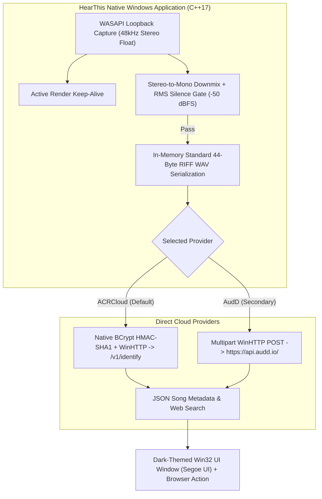

# HearThis 🎵

[](https://en.wikipedia.org/wiki/C%2B%2B17)
[]()
[]()
[](LICENSE)
[]()

HearThis is a lightweight, high-performance native Windows desktop audio recognition application written in modern C++17.

HearThis captures system audio directly from Windows playback via **WASAPI loopback** (Spotify, YouTube, games, browsers) without microphone bleed, gates silence, packages standard linear PCM WAV in memory, and identifies tracks via direct cloud API providers (**ACRCloud** and **AudD**) with sub-second response times.

---

## 💾 Download for Windows

Get the latest release directly from **[GitHub Releases](https://github.com/deepesh70/song-detector/releases/latest)**:

- **Installer**: `HearThis-Setup-v1.2.X.exe` — Ultra-light (~200 KB) Windows setup wizard with Desktop shortcuts and Start Menu entry.
- **Portable**: `HearThis-v1.2.X-portable.zip` — Standalone portable build (~325 KB). Extract and double-click `HearThis.exe` without installation.

---

## 🏛 Architecture Overview



---

## ✨ Engineering Highlights

- **Ultra-Small Binary**: The standalone executable is only **325 KB** (`334,336 bytes`), requiring zero Python, Qt, or external runtime installations.
- **Zero Third-Party Dependencies**: Built entirely using native Windows system DLLs:
  - Audio capture: Windows Audio Session API (`WASAPI` / `IAudioCaptureClient` COM).
  - Secure transport: Windows HTTP Services (`winhttp.dll`).
  - Cryptography: Windows Cryptography Next Generation (`bcrypt.dll` for HMAC-SHA1 and `crypt32.dll` for Base64).
  - User interface: Native Win32 Desktop Window Manager with immersive dark mode (`dwmapi.dll`).
- **Flexible Scan Duration**: Toggle between 10-second scans (recommended for maximum landmark match accuracy) and 5-second quick scans.
- **Automatic Configuration Persistence**: Remembers your ACRCloud Host, Key, Secret, AudD Token, and scan duration across sessions in `%APPDATA%\SongDetector\native_config.txt`.

---

## 📂 Repository Structure

```
song-detector/
├── CMakeLists.txt                         # Industry-standard build specification
├── build.bat                              # One-click Visual Studio MSVC compilation runner
├── include/                               # Public C++ header interfaces
│   └── hearthis/
│       ├── audio_processor.h              # Mono downmix, RMS silence gate, and WAV builder
│       ├── wasapi_capture.h               # WASAPI loopback audio capture
│       └── api_client.h                   # ACRCloud & AudD WinHTTP client + HMAC-SHA1
├── src/                                   # Implementation source files
│   ├── audio_processor.cpp                # Signal processing algorithms
│   ├── wasapi_capture.cpp                 # Windows COM audio engine integration
│   ├── api_client.cpp                     # Native WinHTTP HTTPS transport & crypto
│   └── main.cpp                           # Dark-mode Win32 GUI entrypoint
├── tests/                                 # Automated C++ unit test suites
│   ├── test_processor.cpp                 # Audio processing tests
│   ├── test_capture.cpp                   # WASAPI loopback capture tests
│   └── test_api_client.cpp                # Cryptography & JSON parser tests
├── installer/                             # Inno Setup Windows installer script
│   └── HearThis.iss
└── assets/                                # Multi-resolution icons (.ico, .png)
```

---

## 🛠 Building from Source

### Prerequisites
- Windows 10 or 11 (64-bit)
- Visual Studio 2022 (with "Desktop development with C++" workload) or Build Tools for Visual Studio.

### Method 1: Using `build.bat` (Fastest)
Open any terminal and run:
```cmd
build.bat
```
This compiles the unit tests, executes test suites, and outputs `HearThis.exe` in the root folder.

### Method 2: Using CMake
```cmd
cmake -B build
cmake --build build --config Release
ctest --test-dir build -C Release --output-on-failure
```
The compiled executable will be located at `build/Release/HearThis.exe`.

---

## 📚 Technical Documentation

Comprehensive technical documentation is available in the [`docs/`](docs/) directory:

- [**System Architecture**](docs/architecture.md): Deep dive into the WASAPI loopback engine, audio pipeline, cloud transport, and Win32 UI threading model.
- [**Cloud API & Integration Reference**](docs/api-reference.md): Specification of ACRCloud (HMAC-SHA1) and AudD multipart protocols, payload parameters, and configuration schema.
- [**DSP & Audio Processing Specification**](docs/dsp-specification.md): Mathematical formulations for stereo downmixing, RMS silence gate ($-50\text{ dBFS}$), 16-bit linear PCM quantization, and 44-byte RIFF header packing.
- [**Operator & Execution Guide**](docs/run-guide.md): Build instructions, CTest execution steps, and first-time configuration walkthrough.
- [**Implementation Status & Future Roadmap**](docs/future-implementations.md): Current milestone matrix and planned enhancements (global hotkeys, system tray, local SQLite history).

---

## 📜 License

This project is licensed under the MIT License - see the [LICENSE](LICENSE) file for details.
