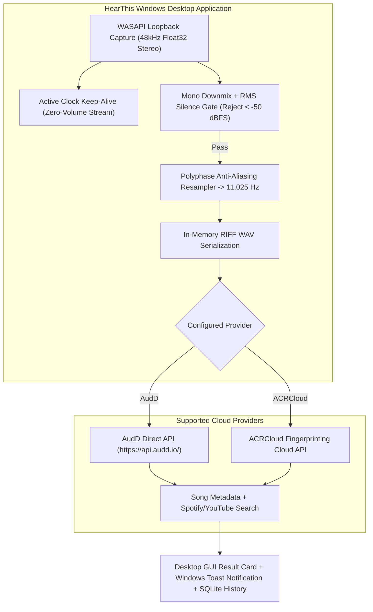

# HearThis 🎵

[](https://www.python.org/downloads/)
[](LICENSE)
[]()
[]()

HearThis is a lightweight, production-grade system audio recognition desktop application for Windows.

HearThis captures audio directly from Windows application playback via **WASAPI loopback** (Spotify, YouTube, games, browsers) without microphone bleed, gates silence, resamples cleanly with polyphase anti-aliasing, and queries commercial music recognition cloud providers (**AudD** and **ACRCloud**) with sub-second response times.

---

## 💾 Download for Windows

Get the latest release directly from **[GitHub Releases](https://github.com/aadit/song-detector/releases/latest)**:

- **Installer (Recommended)**: `HearThis-Setup-v1.0.X.exe` — Windows setup wizard with Desktop shortcuts, Start Menu entry, and uninstaller.
- **Portable**: `HearThis-v1.0.X-portable.zip` — Standalone portable build. Extract and run `HearThis.exe` without installation.

---

## 🏛 Architecture Overview



---

## ✨ Engineering Highlights

- **Lossless System Capture**: Interfaces directly with Windows Audio Session API (`WASAPI`) in loopback mode with a zero-volume render keep-alive to prevent thread stalling during silence.
- **Strict Anti-Aliasing**: Evaluates a Kaiser-windowed polyphase sinc filter resampling native $48\text{ kHz}$ to canonical $11,025\text{ Hz}$ mono, providing over $52\text{ dB}$ stopband attenuation above $5\text{ kHz}$.
- **RMS Silence Gating**: Rejects signals below $-50\text{ dBFS}$ before making outbound network calls, saving bandwidth and API quotas.
- **Direct Cloud Integration**: Connects straight to AudD and ACRCloud with persistent HTTP/1.1 connection pooling (`httpx`), avoiding intermediate proxy latency.
- **Native Win32 Global Hotkeys**: Uses `RegisterHotKey` with a `nativeEvent` window filter for zero-CPU hotkey listening (`Ctrl+Shift+S` / `F9`).
- **Local History Store**: Thread-safe SQLite database storing all identified tracks with search, clipboard copy, and browser playback links.

---

## 📂 Repository Structure

```
song-detector/
├── .github/workflows/ci.yml   # Automated GitHub Actions test workflow
├── installer/HearThis.iss     # Inno Setup Windows installer script
├── HearThis.spec              # PyInstaller standalone binary configuration
├── client/                    # Desktop application source code
│   ├── gui_app.py             # Desktop GUI launcher
│   ├── gui/                   # Modular PyQt6 UI components
│   │   ├── styles.py          # WCAG AA dark theme QSS tokens
│   │   ├── visualizer.py      # Audio spectrum activity visualizer widget
│   │   ├── worker.py          # Non-blocking WASAPI recognition QThread worker
│   │   ├── tabs/              # Decomposed tab views (Identify, History, Settings)
│   │   └── main_window.py     # Main window coordinator, tray icon, and global hotkeys
│   ├── capture.py             # WASAPI loopback recorder with silence keep-alive
│   ├── preprocessor.py        # RMS silence gate and polyphase resampler
│   ├── direct_recognizer.py   # AudD and ACRCloud client recognition engine
│   ├── history_store.py       # Local SQLite history database (recognition_history)
│   ├── config.py              # Local JSON configuration manager
│   ├── notifier.py            # Windows native toast notifications
│   └── agent.py               # Desktop CLI recognition daemon
└── tests/                     # Automated unit and integration test suites
    ├── test_client_gui.py     # GUI configuration, history store, and tab component tests
    └── test_resampler.py      # Stopband attenuation and RMS gate checks
```

---

## 🚀 Quickstart

### 1. Setup Environment
```powershell
conda create -n song-detector python=3.11 -y
conda activate song-detector
pip install -r requirements.txt
```

### 2. Verify with Automated Tests
```powershell
pytest -v
```

### 3. Launch HearThis Desktop App
```powershell
python client/gui_app.py
```

---

## 📜 License

This project is licensed under the MIT License - see the [LICENSE](LICENSE) file for details.
