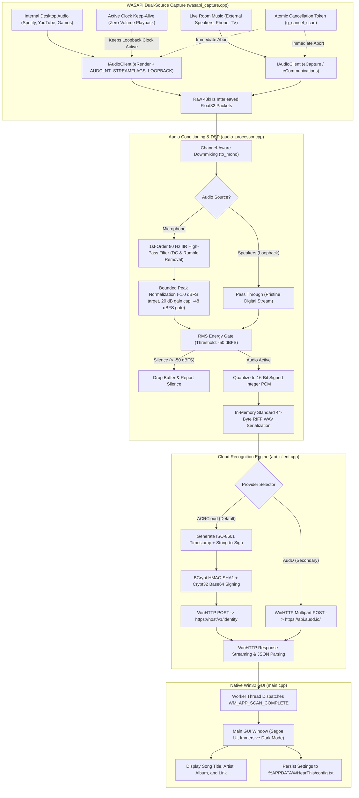

# System Architecture

## 1. System Overview

HearThis is a high-performance native Windows desktop audio identification system engineered in modern C++17. The application runs as a self-contained ~350 KB executable with zero third-party dependencies, linking strictly against native Windows system libraries.

The application captures both internal system audio playback (via WASAPI loopback) and live room music (via physical microphone input), applies acoustic signal conditioning and silence gating, packs standard linear PCM WAV in memory, and queries commercial cloud recognition providers (ACRCloud and AudD) using native Windows cryptographic signing and HTTP transport.

---

## 2. Core Subsystems

### 2.1 WASAPI Dual-Source Capture (`wasapi_capture.cpp`)
HearThis features a unified capture architecture supporting both internal desktop audio and live acoustic room microphone feeds:
- **Audio Source Selection (`AudioSource`)**:
  - `AudioSource::Speakers` (Loopback): Targets `eRender` endpoint with `AUDCLNT_STREAMFLAGS_LOOPBACK`, capturing internal sound streams directly from the Windows mixer without microphone bleed or ambient room acoustics.
  - `AudioSource::Microphone`: Targets `eCapture` with fallback to `eCommunications`, enabling song identification from external sound sources (smartphones, radio, TV, room speakers).
- **Driver Auto-Conversion**: Stream initialization includes `AUDCLNT_STREAMFLAGS_AUTOCONVERTPCM | AUDCLNT_STREAMFLAGS_SRC_DEFAULT_QUALITY`, allowing the Windows Audio Engine to handle hardware sample rate and bit-depth conversion natively.
- **Active Clock Keep-Alive**: When no desktop applications produce sound, WASAPI loopback stops dispatching audio buffer packets. HearThis runs a silent `IAudioRenderClient` stream feeding zero-amplitude frames on a dedicated background thread, keeping the hardware clock ticking continuously.
- **Cooperative Thread Cancellation**: Long scan captures (e.g., 5 to 10 seconds) accept a `std::atomic<bool>* cancel_token`. If the user cancels or closes the application window, the capture loop aborts within milliseconds without blocking the thread pump.

### 2.2 Audio Processing & Acoustic Conditioning (`audio_processor.cpp`)
The audio processing subsystem operates entirely on contiguous in-memory sample vectors:
- **Channel-Aware Downmixing (`to_mono`)**: Handles mono passthrough (1ch), stereo channel averaging (2ch), and multi-channel surround downmixing:
  $$x_{\text{mono}}[n] = \frac{1}{C} \sum_{c=0}^{C-1} x[n \cdot C + c]$$
- **1st-Order 80 Hz IIR High-Pass Filter (`apply_high_pass_filter`)**: External microphone inputs suffer from room rumble, handling noise, and DC bias. A single-pole high-pass filter strips sub-audible low-frequency rumble before analysis:
  $$y[n] = \alpha \cdot (y[n-1] + x[n] - x[n-1]), \quad \alpha = \frac{RC}{RC + \Delta t}, \quad RC = \frac{1}{2\pi \cdot 80}$$
- **Bounded Peak Normalization (`normalize_audio`)**: Room recordings are typically attenuated ($-30$ to $-40\text{ dBFS}$). HearThis scales the audio buffer toward $-1.0\text{ dBFS}$ with a $+20\text{ dB}$ (10x) safety gain ceiling, provided RMS energy is above the $-48\text{ dBFS}$ noise floor gate.
- **RMS Energy Gating (`is_silent`)**: Computes Root-Mean-Square energy across the captured duration:
  $$\text{RMS} = \sqrt{\frac{1}{N} \sum_{n=0}^{N-1} x[n]^2}, \quad \text{dBFS} = 20 \log_{10}(\text{RMS} + 10^{-9})$$
  If $\text{dBFS} < -50$, processing stops immediately, avoiding unnecessary network calls.
- **RIFF WAV Packing (`pcm_to_wav_bytes`)**: Quantizes clamped $[-1.0, 1.0]$ float samples to 16-bit signed PCM integers (`int16_t`) and prepends a canonical 44-byte RIFF header in memory.

### 2.3 Cloud Transport & Native Cryptography (`api_client.cpp`)
Network communication and cryptographic signing are implemented strictly through native Windows DLLs:
- **Windows HTTP Services (`winhttp.dll`)**: Uses native session and connection handles (`HINTERNET`) with automatic TLS 1.2/1.3 negotiation, redirect handling, and proxy resolution.
- **Cryptography Next Generation (`bcrypt.dll`)**: Computes HMAC-SHA1 signatures required by ACRCloud using `BCryptOpenAlgorithmProvider` with `BCRYPT_ALG_HANDLE_HMAC_FLAG`, `BCryptGenerateSymmetricKey`, and `BCryptFinishHash`.
- **Cryptographic Encoding (`crypt32.dll`)**: Converts binary cryptographic digests to URL-safe Base64 strings via `CryptBinaryToStringA(CRYPT_STRING_BASE64 | CRYPT_STRING_NOCRLF)`.

### 2.4 Native Win32 UI & Configuration (`main.cpp`)
- **Native Win32 Controls**: Built with raw `CreateWindowExW`, standard Win32 edit boxes, buttons, drop-down combo boxes, and `Segoe UI` typography.
- **Desktop Window Manager (`dwmapi.dll`)**: Activates Windows 11 immersive dark mode title bars via `DwmSetWindowAttribute(hwnd, DWMWA_USE_IMMERSIVE_DARK_MODE, &enable, sizeof(enable))`.
- **Asynchronous Execution**: UI events trigger background worker threads (`std::thread`), leaving the message pump (`GetMessage`/`DispatchMessage`) unblocked. Thread completion reports back to the UI thread via custom Windows messages (`WM_APP_SCAN_COMPLETE`).
- **Configuration Persistence & Migration**: Settings are persisted at `%APPDATA%\HearThis\config.txt` with automatic legacy migration from `%APPDATA%\SongDetector\native_config.txt`.
