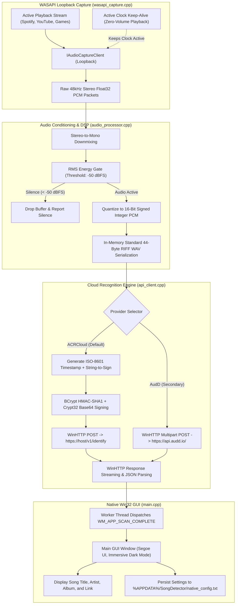

# System Architecture

## 1. System Overview

HearThis is a high-performance native Windows desktop audio identification system engineered in modern C++17. The application runs as a self-contained 325 KB executable with zero third-party dependencies, linking strictly against native Windows system libraries.

The application captures internal system audio playback directly from the Windows audio mixer, performs real-time audio conditioning and silence gating, packs standard linear PCM WAV in memory, and queries commercial cloud recognition providers (ACRCloud and AudD) using native Windows cryptographic signing and HTTP transport.

---

## 2. Core Subsystems

### 2.1 WASAPI Loopback Capture (`wasapi_capture.cpp`)
Capturing internal desktop audio without a microphone requires interfacing with the Windows Audio Session API (`WASAPI`) via Component Object Model (`COM`):
- **Loopback Mode (`AUDCLNT_STREAMFLAGS_LOOPBACK`)**: Attached to `eRender` console endpoint, capturing exact output sent to speakers or headphones without microphone bleed or ambient room noise.
- **Mix Format Handling**: Accepts the audio engine's shared-mode mix format (`WAVE_FORMAT_EXTENSIBLE` / IEEE 32-bit floating-point at $48,000\text{ Hz}$ stereo) without requiring driver resampling.
- **Active Clock Keep-Alive**: When no desktop applications are producing sound, WASAPI loopback stops dispatching audio buffer packets. To prevent worker starvation or deadlock, HearThis initializes a silent `IAudioRenderClient` stream feeding zero-amplitude frames on a dedicated background thread, keeping the hardware clock ticking continuously.

### 2.2 Audio Processing & Silence Gate (`audio_processor.cpp`)
The audio processing subsystem operates on contiguous in-memory sample vectors:
- **Stereo Downmix**: Averages left and right channels into a single mono channel:
  $$x_{\text{mono}}[n] = \frac{x_{\text{left}}[n] + x_{\text{right}}[n]}{2}$$
- **RMS Energy Gating**: Computes Root-Mean-Square energy across the entire captured duration:
  $$\text{RMS} = \sqrt{\frac{1}{N} \sum_{n=0}^{N-1} x[n]^2}, \quad \text{dBFS} = 20 \log_{10}(\text{RMS} + 10^{-12})$$
  If $\text{dBFS} < -50$, processing stops immediately, avoiding unnecessary network calls and battery drain.
- **RIFF WAV Packing**: Converts clamped $[-1.0, 1.0]$ floating-point samples to 16-bit signed PCM integers (`int16_t`) and prepends a canonical 44-byte RIFF header in memory.

### 2.3 Cloud Transport & Native Cryptography (`api_client.cpp`)
Network communication and cryptographic signing are implemented strictly through native Windows DLLs:
- **Windows HTTP Services (`winhttp.dll`)**: Uses native session and connection handles (`HINTERNET`) with automatic TLS 1.2/1.3 negotiation, redirect handling, and proxy resolution.
- **Cryptography Next Generation (`bcrypt.dll`)**: Computes HMAC-SHA1 signatures required by ACRCloud using `BCryptOpenAlgorithmProvider` with `BCRYPT_ALG_HANDLE_HMAC_FLAG`, `BCryptGenerateSymmetricKey`, and `BCryptFinishHash`.
- **Cryptographic Encoding (`crypt32.dll`)**: Converts binary cryptographic digests to URL-safe Base64 strings via `CryptBinaryToStringA(CRYPT_STRING_BASE64 | CRYPT_STRING_NOCRLF)`.

### 2.4 Native Win32 UI & Configuration (`main.cpp`)
- **Native Win32 Controls**: Built with raw `CreateWindowExW`, standard Win32 edit boxes, buttons, radio options, and `Segoe UI` typography.
- **Desktop Window Manager (`dwmapi.dll`)**: Activates Windows 11 immersive dark mode title bars via `DwmSetWindowAttribute(hwnd, DWMWA_USE_IMMERSIVE_DARK_MODE, &enable, sizeof(enable))`.
- **Asynchronous Execution**: UI events trigger background worker threads (`std::thread`), leaving the message pump (`GetMessage`/`DispatchMessage`) unblocked. Thread completion reports back to the UI thread via custom Windows messages (`WM_APP_SCAN_COMPLETE`).
- **Configuration Persistence**: Flat key-value storage in `%APPDATA%\SongDetector\native_config.txt` automatically saves provider selections, credentials, and scan duration preferences.
