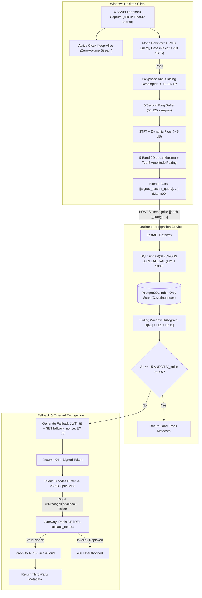

# System Architecture

## 1. System Overview
Song Detector is structured into three distinct operational domains:
1. **Desktop Client Domain (Windows)**: Intercepts native application audio via WASAPI loopback, pre-filters and resamples audio buffers, and extracts discrete landmark hashes.
2. **Recognition & Matching Service Domain (Backend)**: Ingests compact hash payloads, performs covering index lookups against PostgreSQL, evaluates sliding-window histogram prominence, and returns track metadata.
3. **Fallback & Storage Domain**: Houses track catalog metadata, inverted posting lists, Redis token state, and authenticated proxy adapters to commercial recognition providers (AudD / ACRCloud).



---

## 2. Windows Loopback Capture Architecture
Capturing internal application audio without a physical microphone requires interfacing with the Windows Audio Session API (`WASAPI`) in loopback mode (`AUDCLNT_STREAMFLAGS_LOOPBACK`):
- **Native Format Handling**: Windows shared-mode mixers typically stream 32-bit floating-point PCM at $48,000\text{ Hz}$ stereo. The capture engine accepts native hardware frames directly without forcing driver conversion.
- **Clock Keep-Alive**: When no desktop applications are producing sound, WASAPI stops dispatching buffer packets. To prevent worker starvation or indefinite blocking during silence, the client runs a continuous zero-volume render stream alongside the loopback client, maintaining a continuous hardware clock.
- **Silence Gate**: Captures are analyzed for Root-Mean-Square (RMS) energy before processing. Buffers with $\text{dBFS} < -50$ are discarded at zero CPU cost.

---

## 3. Database Architecture & Scalability
- **Storage Strategy**:
  - `tracks`: Stores canonical metadata (title, artist, duration, total hash count).
  - `fingerprints`: Stores discrete integer landmarks `(hash INT, song_id INT, offset_frames INT)`.
- **Index-Only Scans**:
  - A covering index `CREATE INDEX idx_fingerprints_hash_covering ON fingerprints (hash) INCLUDE (song_id, offset_frames);` stores all required columns directly within the B-Tree leaf pages.
  - To prevent fallback to table heap page fetches, the ingestion worker invokes `VACUUM ANALYZE fingerprints;` post-batch to mark pages visible in PostgreSQL's Visibility Map.
- **Mitigating Complexity Attacks**:
  - Malicious or dense common hashes can pull millions of rows. Query execution enforces a per-hash cap using `CROSS JOIN LATERAL (...) LIMIT 1000`.

---

## 4. Fallback Architecture (Two-Step Token Protocol)
1. **Hash First**: Clients send lightweight landmark tuples `[[signed_int32, t_query], ...]`, consuming less than $6\text{ KB}$ of bandwidth.
2. **Cryptographic Single-Use Handshake**: If local catalog matching fails to reach the confidence threshold, the backend generates a short-lived JSON Web Token containing a random UUID `jti`. The `jti` is cached in Redis with a 30-second TTL:
   ```
   SET fallback_nonce:<jti> 1 EX 30 NX
   ```
3. **Controlled Audio Dispatch**: The client compresses the audio buffer into an Opus/MP3 snippet ($\approx 25\text{ KB}$) and dispatches it to `/v1/recognize/fallback` with the Bearer token.
4. **Atomic Invalidation**: The backend executes `GETDEL fallback_nonce:<jti>`. If the key exists, it is deleted atomically and the audio payload is forwarded to AudD/ACRCloud. Replay attacks immediately return `401 Unauthorized`.
