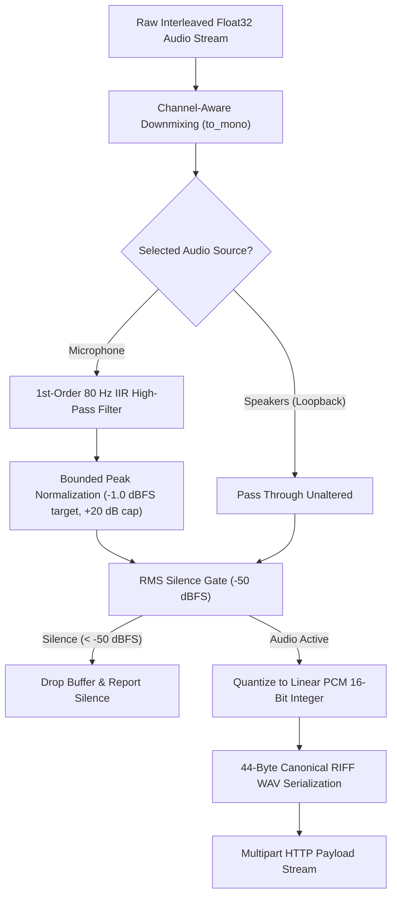

# DSP & Audio Processing Specification

HearThis implements a deterministic audio signal processing pipeline in native C++17 (`audio_processor.cpp`) to capture, condition, filter, and serialize both internal system playback and ambient microphone audio for cloud identification.

---

## 1. Hardware Stream Ingestion

Windows Audio Session API (`WASAPI`) captures audio via the unified `WasapiCapture` interface:

| Parameter | Internal Playback (Speakers) | External Playback (Microphone) |
| :--- | :--- | :--- |
| **Endpoint Category** | `eRender`, `eConsole` | `eCapture`, `eConsole` (fallback: `eCommunications`) |
| **Stream Mode** | Shared mode (`AUDCLNT_STREAMFLAGS_LOOPBACK`) | Shared mode (`0`) |
| **Driver Auto-Conversion** | Enabled (`AUTOCONVERTPCM` + `SRC_DEFAULT_QUALITY`) | Enabled (`AUTOCONVERTPCM` + `SRC_DEFAULT_QUALITY`) |
| **Mix Sampling Rate** | Typically $f_s = 48,000\text{ Hz}$ | Typically $f_s = 48,000\text{ Hz}$ or $44,100\text{ Hz}$ |
| **Mix Sample Format** | 32-bit IEEE 754 Float (`WAVE_FORMAT_IEEE_FLOAT`) | 32-bit IEEE 754 Float (`WAVE_FORMAT_IEEE_FLOAT`) |
| **Interleaving** | Contiguous interleaved multi-channel | Contiguous interleaved multi-channel |

---

## 2. Audio Processing Pipeline

### 2.1 Channel-Aware Downmixing (`to_mono`)
Audio frames captured from WASAPI are multi-channel interleaved 32-bit floats. HearThis supports mono (1 channel), stereo (2 channels), and surround setups (e.g., 4 or 5.1 channels) by computing an arithmetic mean across channels per frame:

$$x_{\text{mono}}[n] = \frac{1}{C} \sum_{c=0}^{C-1} x[n \cdot C + c]$$

Where:
- $n$ is the discrete time frame index ($0 \le n < N$).
- $C$ is the number of hardware channels.
- When $C = 1$, the input vector is returned directly without memory reallocation or mathematical transformation.

### 2.2 Acoustic Physics & Signal Conditioning

#### Why Microphone Conditioning is Mandatory
- **Loopback Audio**: A pristine, full-scale digital feed directly from Windows audio mixer with near-zero noise floor and flat frequency response.
- **Microphone Audio**: An attenuated analog signal recorded through room air. Songs played across a room from a phone or TV typically peak around $-30\text{ dBFS}$ to $-40\text{ dBFS}$ ($0.01$ to $0.03$). Furthermore, laptop and desktop microphones exhibit severe low-frequency room rumble, desk vibration, and DC bias that consume dynamic headroom and distort fingerprinting FFT bins.

#### 1st-Order 80 Hz IIR High-Pass Filter (`apply_high_pass_filter`)
HearThis applies a digital 1st-order Infinite Impulse Response (IIR) RC high-pass filter:

$$y[n] = \alpha \cdot \left( y[n-1] + x[n] - x[n-1] \right)$$

The filter coefficient $\alpha$ is derived from the cutoff frequency $f_c = 80\text{ Hz}$ and sample period $\Delta t = \frac{1}{f_s}$:

$$RC = \frac{1}{2\pi f_c}, \quad \alpha = \frac{RC}{RC + \Delta t}$$

This removes DC offset and strips sub-audible mains hum ($50\text{ Hz} / 60\text{ Hz}$) while preserving fundamental musical basslines.

#### Bounded Peak Normalization (`normalize_audio`)
To ensure recognition engines receive adequate signal amplitude without amplifying background thermal hiss:
1. Compute peak amplitude $M = \max_{n} |x[n]|$ and RMS energy:
   $$\text{RMS} = \sqrt{\frac{1}{N} \sum_{n=0}^{N-1} x[n]^2}, \quad \text{RMS}_{\text{dBFS}} = 20 \log_{10}(\text{RMS} + 10^{-9})$$
2. **Noise Gate Floor Check**: If $\text{RMS}_{\text{dBFS}} < -48.0\text{ dBFS}$ or $M < 10^{-4}$, the buffer is classified as room background noise and returned unamplified.
3. **Bounded Gain Application**: Otherwise, calculate linear target peak $T = 10^{\frac{-1.0}{20}} \approx 0.89125$ and apply bounded scaling:
   $$\text{Gain} = \min\left( \frac{T}{M}, 10.0 \right)$$
   Every sample is clamped to avoid digital overflow:
   $$x_{\text{normalized}}[n] = \text{clamp}(x[n] \cdot \text{Gain}, -1.0, 1.0)$$

---

## 3. RMS Silence Energy Gate

To prevent wasteful cloud API calls and false positives when neither desktop audio nor ambient room music is playing, the signal passes through a Root-Mean-Square (RMS) silence gate:

$$\text{dBFS} = 20 \log_{10}(\text{RMS} + 10^{-9})$$

$$\text{Decision} = \begin{cases} \text{Pass (Valid Audio)} & \text{if } \text{dBFS} \ge -50.0\text{ dBFS} \\ \text{Drop (Digital Silence)} & \text{if } \text{dBFS} < -50.0\text{ dBFS} \end{cases}$$

Buffers failing this gate are dropped immediately in memory, and the user interface displays `"Silence detected. Play audio before scanning."` without dispatching network packets.

---

## 4. Linear PCM Quantization & Serialization

Cloud recognition endpoints mandate standard 16-bit linear PCM (`WAVE_FORMAT_PCM`).

### 4.1 Quantization & Hard Saturation
Normalized floating-point samples in $[-1.0, 1.0]$ are quantized to signed 16-bit integers ($[-32768, 32767]$) with hard saturation clipping:

$$x_{16}[n] = \text{clamp}\left( \lfloor x_{\text{mono}}[n] \times 32767.0 \rfloor, -32768, 32767 \right)$$

### 4.2 Canonical 44-Byte RIFF WAV Serialization
The quantized integers are serialized directly into a contiguous heap buffer prefixed with a standard 44-byte RIFF/WAVE header:

| Byte Offset | Field | Value (Hex / String) | Description |
| :--- | :--- | :--- | :--- |
| `0x00 - 0x03` | `ChunkID` | `"RIFF"` | Resource Interchange File Format signature |
| `0x04 - 0x07` | `ChunkSize` | `36 + SubChunk2Size` | Total file size minus 8 bytes |
| `0x08 - 0x0B` | `Format` | `"WAVE"` | WAV format container identifier |
| `0x0C - 0x0F` | `Subchunk1ID` | `"fmt "` | Format subchunk marker (with trailing space) |
| `0x10 - 0x13` | `Subchunk1Size` | `16` | Size of format chunk (PCM = 16) |
| `0x14 - 0x15` | `AudioFormat` | `1` | Linear PCM format |
| `0x16 - 0x17` | `NumChannels` | `1` | Mono channel |
| `0x18 - 0x1B` | `SampleRate` | `48000` | Sample frequency in Hz |
| `0x1C - 0x1F` | `ByteRate` | `96000` | $\text{SampleRate} \times \text{NumChannels} \times \frac{\text{BitsPerSample}}{8}$ |
| `0x20 - 0x21` | `BlockAlign` | `2` | $\text{NumChannels} \times \frac{\text{BitsPerSample}}{8}$ |
| `0x22 - 0x23` | `BitsPerSample` | `16` | Bit depth per sample |
| `0x24 - 0x27` | `Subchunk2ID` | `"data"` | Data subchunk marker |
| `0x28 - 0x2B` | `Subchunk2Size` | $N \times 2$ | Total raw PCM payload bytes |
| `0x2C - ...`  | `Data` | Binary samples | Contiguous 16-bit little-endian PCM |

---

## 5. Scan Duration Analysis

HearThis supports both quick checks and full landmark matching:

| Parameter | 5-Second Scan | 10-Second Scan (Default) |
| :--- | :--- | :--- |
| **Discrete Audio Samples (at 48 kHz)** | $240,000$ frames | $480,000$ frames |
| **Raw PCM Payload Size** | $480,000$ bytes | $960,000$ bytes |
| **Serialization Overhead** | $< 0.5\text{ ms}$ | $< 0.8\text{ ms}$ |
| **Recognition Precision** | High for loud foreground tracks | Optimal for distant room music and ambient noise |
